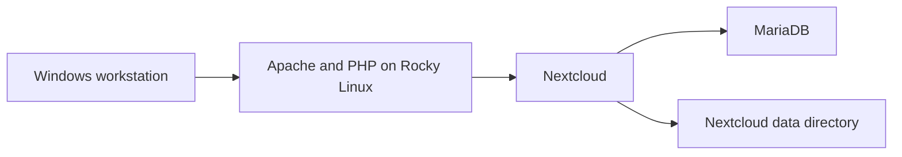

# Nextcloud on Rocky Linux

I deployed Nextcloud on a Rocky Linux virtual machine and verified that a Windows workstation could sign in through the browser. This lab covered web and database setup, service permissions, and troubleshooting across two operating systems.

## Architecture

## Implementation

- Installed Apache, PHP and its required extensions, and MariaDB on the Rocky Linux VM.
- Created a dedicated database and application account and configured an Apache virtual host.
- Used the Nextcloud installer to connect the application to MariaDB. Checked directory ownership and permissions for the Apache service account.
- Opened the Nextcloud dashboard from a separate Windows workstation and reviewed the administration page for setup warnings.

## Validation

| Check | Lab record |
| --- | --- |
| Sign in from Windows | The original capture shows the dashboard after login. |
| Upload a file and retain data across a reboot | The original lab notes record both checks as successful. |
| HTTPS | The administration capture reported an HTTP connection during the initial lab. |
| SELinux | The lab used permissive mode while resolving installation issues. Enforcement was listed as follow-up work. |

## Follow-up

Configure HTTPS, verify the application under SELinux enforcing mode, and test a restore from a clean VM snapshot using a copy of the database and data directory.

[Implementation and validation notes](docs/README.md)
